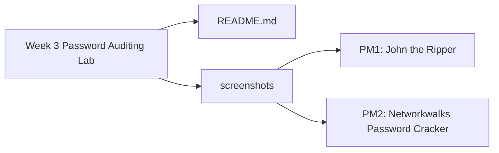

<div align="center">

# 🔐 Week 3: PDF Password Auditing with John the Ripper

### Authorized PDF password-auditing labs from the Networkwalks Cybersecurity Internship

**by Mulenga Chiwele** · Batch BO83 · 18 November 2026


[Overview](#overview) · [Modules](#modules-summary) · [Write-ups](#module-write-ups) · [Results](#final-results-summary) · [Recommendations](#recommendations) · [Contact](#about-the-author)

</div>

---

## Table of Contents

- [Overview](#overview)
- [Objectives](#objectives)
- [Lab Environment](#lab-environment)
- [Modules Summary](#modules-summary)
- [Module Write-ups](#module-write-ups)
- [Final Results Summary](#final-results-summary)
- [Methodology](#methodology)
- [Security Lessons Learned](#security-lessons-learned)
- [Defensive Recommendations](#recommendations)
- [Key Takeaways](#key-takeaways)
- [Command Cheat Sheet](#command-cheat-sheet)
- [Skills Demonstrated](#skills-demonstrated)
- [Repository Structure](#repository-structure)
- [Evidence](#evidence)
- [Project Report](#project-report)
- [About the Author](#about-the-author)
- [Disclaimer](#disclaimer)
- [Copyright](#copyright)

---

## Overview

This repository documents my Week 3 work in the [Networkwalks](https://networkwalks.com) Cybersecurity Internship. The labs covered authorized PDF password auditing with John the Ripper on Kali Linux, followed by the Networkwalks browser-based password cracker.

All work was done against the instructor-provided sample file `My Locked PDF1.pdf` in a controlled learning environment.

**Ethics statement:** Testing was restricted to the course-provided sample PDF. No real user accounts, third-party systems or personal data were targeted. Password-auditing tools must only be used with explicit authorization.

## Objectives

- Understand how password hashes are extracted from protected files.
- Learn how dictionary attacks work and what makes them succeed.
- Verify recovered passwords independently before reporting them.
- Compare a command-line auditing workflow with a browser-based one.
- Draw practical lessons on password strength and the handling of sensitive evidence.

## Lab Environment

| Item | Details |
|------|---------|
| Operating system | Kali Linux |
| Primary tool | John the Ripper (`/usr/sbin/john`) |
| Hash extraction | `pdf2john.pl` (`/usr/share/john/pdf2john.pl`) |
| Dictionary | `rockyou.txt` (`/usr/share/wordlists/rockyou.txt`) |
| Browser tool | Networkwalks Password Cracker |
| Verification | PDF viewer |
| Target | Instructor-provided sample PDF |
| Project date | 18 November 2026 |

## Modules Summary

| # | Module | Category | Outcome |
|:-:|--------|----------|---------|
| PM1 | [Password cracking with John the Ripper](#pm1-password-cracking-with-john-the-ripper) | Offline dictionary attack | Password recovered and verified by opening the PDF |
| PM2 | [Password cracking with Networkwalks tools](#pm2-password-cracking-with-networkwalks-tools) | Browser-based auditing | Controlled demonstration completed and matched the PM1 result |

---

## Module Write-ups

### PM1: Password Cracking with John the Ripper

**Category:** Offline dictionary attack

**Scenario:** Recover the password of the instructor-provided protected PDF and verify the result by opening the file.

**Approach:**

1. Created a dedicated lab folder for the PDF, hash, wordlist and evidence:

   ```bash
   mkdir -p ~/week3-lab/{evidence,hashes}
   cd ~/week3-lab
   ```

2. Located the PDF hash converter:

   ```bash
   find /usr/share/john -name "pdf2john*" 2>/dev/null
   ```

3. Extracted the PDF hash into a file John can process:

   ```bash
   /usr/share/john/pdf2john.pl "My Locked PDF1.pdf" > hashes/pdf1.hash
   ```

4. Unpacked the Kali dictionary:

   ```bash
   gunzip /usr/share/wordlists/rockyou.txt.gz
   ```

5. Ran the dictionary attack:

   ```bash
   john --format=pdf --wordlist=/usr/share/wordlists/rockyou.txt hashes/pdf1.hash
   ```

6. Displayed the recovered result:

   ```bash
   john --show --format=pdf hashes/pdf1.hash
   ```

7. Opened the protected PDF with the recovered password to confirm it was correct.

**Findings:**

- The extracted hash began with `$pdf$`. The full hash is redacted in this repository.
- John reported 1 password hash cracked, 0 left.
- The protected PDF opened successfully with the recovered password.

**What I learned:** A common, predictable password is found quickly by a dictionary attack. Verifying the result by opening the file confirms the finding before it is reported.

---

### PM2: Password Cracking with Networkwalks Tools

**Category:** Browser-based password auditing

**Scenario:** Demonstrate the browser-based PDF password-auditing workflow using the Networkwalks Password Cracker.

**Approach:**

1. Opened the Networkwalks Password Cracker in the browser.
2. Supplied the PDF-compatible hash from `pdf2john.pl`. The Hash Calculator page produced general MD5/SHA hashes, which the cracker does not accept for PDFs.
3. Tested the built-in password list first. It returned no match.
4. Created a small controlled wordlist, because uploading the full `rockyou.txt` caused browser performance problems:

   ```bash
   printf "123456\npassword\ngood-luck\n" > ~/week3-lab/small-wordlist.txt
   ```

**Findings:**

- The built-in list did not match.
- The controlled wordlist produced a successful match for the same password recovered in PM1.

**Transparency note:** The independent recovery was done with John the Ripper and `rockyou.txt`. The small wordlist was used only to complete the browser demonstration after the large upload became impractical.

**What I learned:** Browser tools are convenient but limited by upload size and hash format. Results depend on the wordlist and the input format, so a tool's result should be read in that context.

---

## Final Results Summary

| Module | Method | Outcome |
|--------|--------|---------|
| PM1 | John the Ripper with `rockyou.txt` | Password recovered and verified by opening the PDF |
| PM2 | Networkwalks Password Cracker | Controlled browser demonstration completed |
| Verification | PDF viewer | Protected sample PDF opened successfully |

## Methodology

1. **Confirm authorization** and scope before any activity.
2. **Prepare** an isolated lab folder so evidence and hashes stay organized.
3. **Extract** the hash using the appropriate converter for the file type.
4. **Attack** with a dictionary, starting with a well-known wordlist.
5. **Verify** every recovered password by using it on the original file.
6. **Document** the method, including any changes to the workflow and why they were made.
7. **Redact** passwords, full hashes and flags before publishing evidence.

## Security Lessons Learned

- Short and predictable passwords are vulnerable to dictionary attacks.
- A password hash is not a substitute for a strong password.
- Attack results depend on the wordlist, the file format and the tool configuration.
- Large wordlists can cause performance problems in browser-based tools.
- Public evidence must be redacted before publication.
- Authorization and scope must be confirmed before any security test.

## Recommendations

- Use long, unique passphrases rather than common words or predictable patterns.
- Never reuse passwords across systems or files.
- Protect sensitive files with strong encryption and careful key handling.
- Keep password-auditing evidence private unless publication is authorized.
- Test only instructor-provided or explicitly authorized targets.

## Key Takeaways

- Predictable passwords fall quickly to dictionary attacks, even when the underlying hash is strong.
- Verifying a recovered password against the original file is essential before reporting it.
- Browser-based tools are useful for demonstrations but may not handle large inputs or every hash format.
- Documenting deviations from the planned method keeps results honest and reproducible.
- Strong, unique passphrases are the simplest and most effective defense.

## Command Cheat Sheet

| Purpose | Command |
|---------|---------|
| Find the PDF hash converter | `find /usr/share/john -name "pdf2john*" 2>/dev/null` |
| Extract the PDF hash | `/usr/share/john/pdf2john.pl "My Locked PDF1.pdf" > hashes/pdf1.hash` |
| Run a dictionary attack | `john --format=pdf --wordlist=/usr/share/wordlists/rockyou.txt hashes/pdf1.hash` |
| Show cracked results | `john --show --format=pdf hashes/pdf1.hash` |
| Unpack rockyou.txt | `gunzip /usr/share/wordlists/rockyou.txt.gz` |

## Skills Demonstrated

| Area | Details |
|------|---------|
| **Hash extraction** | Converting protected PDFs into John-compatible hash format |
| **Dictionary attacks** | Running John the Ripper with a wordlist and reading the results |
| **Result verification** | Confirming recovered passwords by opening the protected file |
| **Tool comparison** | Comparing command-line and browser-based auditing workflows |
| **Transparency** | Documenting method changes and their reasons |
| **Evidence handling** | Redacting passwords, full hashes and flags before publishing |

## Repository Structure

The repository contains this `README.md` with the full Week 3 write-up, and a `screenshots` folder with the evidence for each module:

- **PM1:** Password cracking with John the Ripper
- **PM2:** Password cracking with Networkwalks tools



## Evidence

<p align="center">
  
</p>

<p align="center">
  
</p>

<p align="center">
  
</p>

## Project Report

📄 **[Download the Week 3 Project Report](./Week3-Project-Report.pdf)**

## About the Author

**Mulenga Chiwele**
Aspiring Security Analyst | Network Security

I am building hands-on skills in password auditing, network analysis and ethical security testing, with an emphasis on authorized scope and clear documentation.

- GitHub: [mulengachiwele174-afk](https://github.com/mulengachiwele174-afk)
- LinkedIn: [Mulenga Chiwele](https://www.linkedin.com/in/mulenga-chiwele-712a64365)
- Email: [Mulengachiwele174@gmail.com](mailto:Mulengachiwele174@gmail.com)

## Disclaimer

This repository is for educational and defensive-security learning only. It does not authorize testing of any system, account or file mentioned in the project. Raw passwords, full hashes, flags and unnecessary sensitive evidence have been excluded from the public version.

## Copyright

© 2026 Mulenga Chiwele. All Rights Reserved.

This write-up, including its structure, analysis and wording, is the original work of **Mulenga Chiwele**. You are welcome to read and link to it. Please do not copy, republish or present it as your own without written permission.

Enquiries: [Mulengachiwele174@gmail.com](mailto:Mulengachiwele174@gmail.com)

---

<div align="center">

### © 2026 Mulenga Chiwele · All Rights Reserved

This write-up is the original work of **Mulenga Chiwele**. You are welcome to read and link to it. Please do not copy or republish it as your own without permission.

<sub>Week 3 PDF Password Auditing with John the Ripper · 18 November 2026 · Document ID: `MC-WPAL-2026-1118`</sub>

<sub>Enquiries: [Mulengachiwele174@gmail.com](mailto:Mulengachiwele174@gmail.com)</sub>

</div>

<!--
Original work by Mulenga Chiwele (github.com/mulengachiwele174-afk)
Week 3 PDF Password Auditing with John the Ripper · Document ID: MC-WPAL-2026-1118
Unauthorized copying or republishing without credit is not permitted.
-->
